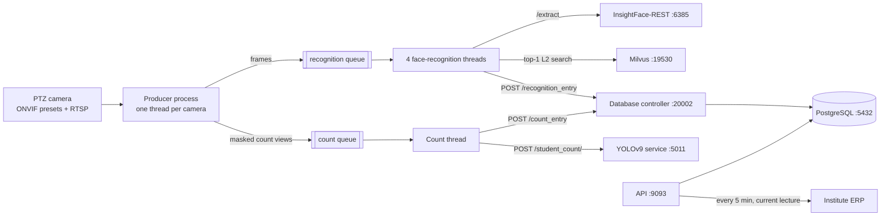

# PTZ Camera Classroom Attendance System

Lecture-wise classroom attendance from a single PTZ camera per room. The camera sweeps ONVIF presets across the classroom, faces are matched against enrolled embeddings in Milvus, a YOLOv9 service estimates the headcount, results are stored in PostgreSQL, and attendance is pushed to the institute's ERP every 5 minutes.

This project extends [Multi-Person-Face-Recognition](https://github.com/anubhavpatrick/Multi-Person-Face-Recognition) (the CCTV attendance system) and reuses its standalone InsightFace-REST, Milvus and PostgreSQL services.

## Architecture



| Compose service | Container | Port | GPU | Role |
|---|---|---|---|---|
| `classroom-attendance-ptz-camera` | `ptz-classroom-face-recognition-producer-consumer` | — | — | Camera control, frame capture, face recognition, count requests (`src/main.py`) |
| `ptz-database-controller` | `ptz-classroom-face-recognition-database-controller` | 20002 | — | FastAPI ingestion into partitioned PostgreSQL tables |
| `ptz-api` | `ptz-classroom-face-recognition-api` | 9093 → 8000 | — | Lecture data API, manual resend, scheduled ERP export |
| `yolov9-person-detection-for-student-count` | `ptz-classroom-face-recognition-student-count_yolov9` | 5011 | MIG `7:2` | YOLOv9-e person detection for headcount |

External services (not in this Compose file): InsightFace-REST (`:6385`), Milvus (`:19530`) and PostgreSQL (`:5432`), reached at `IP_ADDRESS`. Face liveness detection (`:6386`) is supported but disabled (`ENABLE_FACE_LIVENESS_DETECTION = False`).

## How it works

1. **Camera cycle** (09:00–16:40). For each camera: faculty preset, reset, the room's class-trace presets, reset, then the two counting positions (right and left). Each preset captures `number-of-frames` frames over RTSP. Within one minute of a lecture's start or end, the faculty preset is captured continuously for 5 minutes.
2. **Recognition.** Frames go to InsightFace-REST for detection and 512-d embeddings, then to Milvus for a top-1 L2 search. Matches with distance ≤ 0.95 are sent to the database controller.
3. **Headcount.** One frame from each counting position is resized to 2304×1312 and sent to the YOLOv9 service. The per-lecture count stored in `lecture_summary` is the most frequent value (highest on ties).
4. **Storage.** `lecture_summary`, `attendance_log` and `student_detection_count`, range-partitioned by year. A person seen again in the same classroom within 5 minutes is not logged twice. Roles (student/faculty) come from institute-specific ID formats.
5. **Export.** Every 5 minutes from 09:00 to 17:59, the API sends the current lecture's recognitions to the classroom's ERP endpoint and sets `attendance_valid` when the ERP confirms.

## Prerequisites

- Docker with Docker Compose and the NVIDIA Container Toolkit (the counting service needs a GPU; adjust `device_ids` in `docker-compose.yml` for your host).
- InsightFace-REST, Milvus and PostgreSQL running and reachable from this host (start them from the CCTV attendance project's standalone services).
- A Milvus collection `<INSTITUTE>_FACE_DATA_COLLECTION_FOR_L2` populated with enrolled face embeddings. This project only searches it.
- YOLOv9 weights `yolov9-e-converted.pt` and `best.pt` in the project root before building (they are gitignored and copied into the counting image).

## Setup

```bash
git clone git@github.com:hamza-aziz-ai/PTZ-Camera-Classroom-Attendance-System.git
cd PTZ-Camera-Classroom-Attendance-System
find . -type f -name "*.sh" -exec chmod +x {} \;

# Secrets: credentials, camera IPs, ERP endpoints, host IPs
cp secrets.env.example secrets.env
nano secrets.env

# Start (detects the host IP, selects the institute, writes master.env, runs docker-compose up -d)
./start_project.sh

# Stop
./stop_project.sh
```

`secrets.env` and `master.env` are gitignored. Never commit them.

## Configuration

| File | Holds |
|---|---|
| `secrets.env` | PostgreSQL user/password, `API_KEY`, camera port/username/password, camera IP and ERP endpoint per classroom, host IP for each institute. Template: `secrets.env.example` |
| `master.env` | `INSTITUTE` and `IP_ADDRESS`, written by `set_configuration.sh` from the host IP. Template: `master.env.example` |
| `src/parameters.py` | Institute profiles (classrooms, lecture times), service ports, batch/thread settings, Milvus metric and threshold, dedup window |
| `src/camera_configuration_files/<INSTITUTE>/<classroom>.json` | Preset sequence, frames per preset, delays, counting positions and optional masking polygons |

Configured classrooms:

| Classroom | Institute profile | Camera configuration |
|---|---|---|
| supernova | ABESIT | `src/camera_configuration_files/ABESIT/supernova.json` |
| 2F-32 | ABESIT | `src/camera_configuration_files/ABESIT/2F-32.json` |
| AB-1_319 | GLBITM | `src/camera_configuration_files/GLBITM/AB-1_319.json` |

## API

Both endpoints take the API key as the `api_key` query parameter. Dates use `DD-MM-YYYY`.

```bash
# Lecture summary, recognised students/faculty, attendance log and count history
curl "http://<host>:9093/lecture_data?lecture_id=1&lecture_date=22-10-2026&classroom_name=2F-32&api_key=$API_KEY"

# Resend a lecture's stored recognitions to the ERP
curl -X POST "http://<host>:9093/manual_attendance_update?lecture_id=1&lecture_date=22-10-2026&classroom_name=2F-32&api_key=$API_KEY"
```

Internal endpoints (called by the producer-consumer, not for external use): `POST :20002/recognition_entry`, `POST :20002/count_entry`, `POST :5011/student_count/`.

## Logs and saved frames

- Logs: `/workspace/FACE_RECOGNITION_ATTENDANCE_SYSTEM_LOGS/PTZ-Classroom-Attendance-System/<YYYY>/<Month>/<logger>/`, rotated daily, 31 days kept.
- Captured frames (`SAVE_FRAMES = True`): `/workspace/CLASSROOM-ATTENDANCE-TESTING/<DD-Month-YYYY>/Lecture_<n>/Classroom_<name>/`.

## Utilities

| Script | Purpose |
|---|---|
| `src/util/plot_bbox_face_recognition.py` | Re-run recognition on a lecture's saved frames and draw labelled boxes |
| `src/util/plot_bbox_student_count.py` | Re-run person detection on saved counting frames |
| `src/util/generate_attendance_report.py` | Write per-classroom attendance text files from a lecture's JSON |
| `src/util/get_ptz_info.py <camera_ip>` | List a camera's PTZ-capable ONVIF profiles |
| `run_scripts.sh` + `automated-bbox-plotter.Dockerfile` | Weekday 17:00 cron running both plotters (image not part of the Compose stack) |

## Project structure

```
src/
  main.py                          entry point: Milvus, producer, consumers
  ptzcam_multistream_producer.py   PTZ camera control and frame capture
  multicam_stream_consumer.py      face-recognition worker threads
  consumer_for_counting_students.py
  insightface_face_detection.py    InsightFace-REST client
  insightface_face_recognition.py  search, formatting, ingestion call
  milvus_server.py                 Milvus connection, collection, search
  database_server/                 ingestion controller and PostgreSQL model
  api/                             lecture data API and ERP scheduler
  StudentCount/                    YOLOv9 counting service (vendored YOLOv9)
  camera_configuration_files/      per-classroom preset files
  util/                            offline reporting and debugging scripts
```

## Credits

Anubhav Patrick, Hamza Aziz, Kshitij Parashar. The counting service vendors [YOLOv9](https://github.com/WongKinYiu/yolov9), licensed under GPL-3.0 (`src/StudentCount/yolov9/LICENSE.md`).
